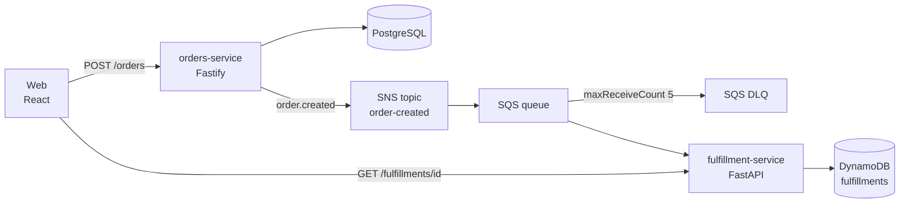

# delivery-events-platform

[Português (Brasil)](README.md) · **English (US)**

Brewdrop is a small beverage-delivery counter used as a working sample of an event-driven Node.js and Python stack. It is meant to be read, run, and extended. It does not claim usage numbers or an operating history.

## Architecture

The counter and the fulfillment desk do not call each other. The order row is the source of the fact; the queue is how the fact arrives.



A failed SNS publish returns 503 and keeps the row. The same `Idempotency-Key` publishes the original event. A failed consume leaves the SQS message in place until the redrive policy moves it to the DLQ. A repeated event for an order that is already accepted does not change the DynamoDB item.

The sequence and the production/local split are in [docs/architecture.md](docs/architecture.md).

## Tech stack

| Piece | Choice |
| --- | --- |
| Orders API | Node.js 22, TypeScript, Fastify, Zod, PostgreSQL |
| Fulfillment API and consumer | Python 3.12, FastAPI, boto3 |
| Event bus | SNS topic to an SQS queue, plus a DLQ (`maxReceiveCount` 5) |
| Fulfillment store | DynamoDB, idempotent on `orderId` |
| Local AWS | LocalStack 4.14 (SNS, SQS, DynamoDB) |
| Containers | Dockerfiles for both services and the web page |
| Kubernetes | Helm chart `deploy/helm/delivery-platform` |
| Cloud reference | Terraform: VPC, EKS, RDS PostgreSQL, SNS, SQS, DynamoDB, ECR, IRSA |
| Web | React, TypeScript, Vite |
| CI | GitHub Actions |

Production data stores are RDS and DynamoDB. Compose runs PostgreSQL 16 and LocalStack instead. Resource names differ; both processes read them from the environment.

## Run locally

Docker is required.

```bash
docker compose up --build -d
./scripts/e2e-local.sh
```

| URL | What |
| --- | --- |
| http://localhost:8080 | Web page |
| http://localhost:3001/health | Orders health |
| http://localhost:8000/health | Fulfillment health |
| http://localhost:8000/docs | Fulfillment OpenAPI |

Create an order by hand:

```bash
curl -s -X POST localhost:3001/orders \
  -H 'content-type: application/json' \
  -H 'idempotency-key: demo-1' \
  -d '{"customerName":"Ada Lovelace","address":"1 Market St","items":[{"sku":"ESP","name":"Espresso","quantity":2}]}'
```

Then `GET /fulfillments/{id}` on port 8000 until `status` is `accepted`.

`scripts/init-localstack.sh` creates the topic, queue, DLQ, subscription, and table. Compose runs it before the services start. It is safe to run again.

Stop and drop local data:

```bash
docker compose down -v
```

For the web page against already-running APIs, without the Compose web image:

```bash
cd web && npm ci && npm run dev
```

The dev server proxies `/orders-api` and `/fulfillment-api`. Details are in [docs/specs/local-platform.md](docs/specs/local-platform.md).

## Tests

```bash
cd services/orders-service
npm ci
npm run lint
npm run typecheck
npm test
```

The PostgreSQL test runs when `DATABASE_URL` is set. CI sets it. Without it, that file is skipped and the in-memory API tests still run.

```bash
cd services/fulfillment-service
python3 -m venv .venv && . .venv/bin/activate
pip install -e ".[dev]"
ruff check src tests
pytest
```

Fulfillment tests use moto. They do not need LocalStack.

```bash
cd web && npm ci && npm run typecheck && npm run build
```

The cross-service check is `./scripts/e2e-local.sh` after Compose is up.

## Deploy to kind with Helm

Build the images, load them into a kind cluster named `delivery`, and install with the kind values. That overlay starts Postgres inside the cluster and leaves the SQS consumer off, because kind has no LocalStack. The event path is the Compose flow above.

```bash
docker build -t orders-service:local services/orders-service
docker build -t fulfillment-service:local services/fulfillment-service
kind create cluster --name delivery
kind load docker-image orders-service:local --name delivery
kind load docker-image fulfillment-service:local --name delivery

helm upgrade --install delivery deploy/helm/delivery-platform \
  --namespace delivery --create-namespace \
  -f deploy/helm/delivery-platform/values-kind.yaml
```

Port-forward, IRSA annotations, and tearing the cluster down are in [docs/kind.md](docs/kind.md).

```bash
helm lint deploy/helm/delivery-platform
helm template delivery deploy/helm/delivery-platform >/dev/null
```

## Terraform

The stack in `infra/terraform` is the AWS shape of the same system: VPC and EKS (community modules), RDS PostgreSQL, SNS, SQS with a DLQ and redrive policy, DynamoDB, ECR, and IRSA roles for the `orders` and `fulfillment` service accounts.

**Applying it creates resources AWS bills for while they exist, including the EKS control plane, a NAT gateway, a worker node, and RDS.** CI does not apply it. CI only runs:

```bash
cd infra/terraform
terraform init -backend=false -input=false
terraform fmt -check -recursive
terraform validate
```

`validate` checks the configuration. It does not call AWS. Read [infra/terraform/README.md](infra/terraform/README.md) before any plan or apply, including how the S3 backend is supplied and how outputs map onto Helm.

## ADLC

The agentic development lifecycle used for this repo has four steps. A longer note is in [docs/adlc.md](docs/adlc.md).

1. **Spec.** `docs/specs/` is the assignment for each component: behavior, data, failures, and what a test must show. The event shape both services share is [docs/specs/event-contract.md](docs/specs/event-contract.md). An agent implements from the spec.
2. **Implementation.** Cursor or Codex writes the code inside the constraints in [AGENTS.md](AGENTS.md) and `.cursor/rules/delivery-platform.mdc`: two services, parameterized SQL, idempotent consumption, no `terraform apply`. If the spec and the code disagree, the spec is updated in the same change.
3. **Human review.** A person checks the diff for retry and idempotency, for messages that must reach the DLQ, and for IAM that is wider than the topic, queue, and table. Tests do not replace that read.
4. **Tests and CI.** Lint and tests for both services, web typecheck and build, `terraform fmt` / `validate`, and `helm lint` run on every pull request. The Compose script covers SNS → SQS → DynamoDB when that path changes.

This is a description of the workflow the repository is set up for. It is not a measurement of speed or quality, and it does not attribute the work to a particular person.

## Specs

| Spec | Component |
| --- | --- |
| [orders-service](docs/specs/orders-service.md) | HTTP API, PostgreSQL, SNS publish |
| [fulfillment-service](docs/specs/fulfillment-service.md) | SQS consumer, DynamoDB, status API |
| [event-contract](docs/specs/event-contract.md) | `order.created` |
| [local-platform](docs/specs/local-platform.md) | Compose and LocalStack |
| [infrastructure](docs/specs/infrastructure.md) | Terraform resources |
| [web](docs/specs/web.md) | React page |
