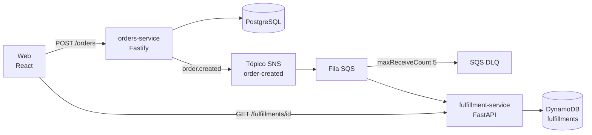

# delivery-events-platform

**Português (Brasil)** · [English (US)](README.en-US.md)

Brewdrop é um balcão pequeno de entrega de bebidas. Serve como exemplo executável de uma stack Node.js e Python orientada a eventos. O código foi feito para ser lido, executado e estendido. Não há números de uso nem histórico operacional atribuídos a ninguém.

## Arquitetura

O balcão e a expedição não se chamam por HTTP. A linha do pedido é a fonte do fato; a fila é o caminho por onde o fato chega.



Se a publicação no SNS falha, a API responde 503 e a linha permanece. A mesma `Idempotency-Key` republica o evento original. Se o consumo falha, a mensagem fica na fila SQS até a política de redrive levá-la para a DLQ. Um evento repetido de um pedido já aceito não altera o item no DynamoDB.

A sequência e a diferença entre o ambiente local e o de produção estão em [docs/architecture.md](docs/architecture.md).

## Stack

| Peça | Escolha |
| --- | --- |
| API de pedidos | Node.js 22, TypeScript, Fastify, Zod, PostgreSQL |
| API e consumidor de expedição | Python 3.12, FastAPI, boto3 |
| Barramento | Tópico SNS para uma fila SQS, com DLQ (`maxReceiveCount` 5) |
| Estado da expedição | DynamoDB, idempotente em `orderId` |
| AWS local | LocalStack 4.14 (SNS, SQS, DynamoDB) |
| Containers | Dockerfiles dos dois serviços e da página web |
| Kubernetes | Chart Helm `deploy/helm/delivery-platform` |
| Referência de nuvem | Terraform: VPC, EKS, RDS PostgreSQL, SNS, SQS, DynamoDB, ECR, IRSA |
| Web | React, TypeScript, Vite |
| CI | GitHub Actions |

Em produção os dados ficam no RDS e no DynamoDB. O Compose sobe PostgreSQL 16 e LocalStack no lugar deles. Os nomes dos recursos diferem; os dois processos leem esses nomes do ambiente.

## Rodar localmente

É preciso ter Docker.

```bash
docker compose up --build -d
./scripts/e2e-local.sh
```

| URL | O que é |
| --- | --- |
| http://localhost:8080 | Página web |
| http://localhost:3001/health | Saúde do orders |
| http://localhost:8000/health | Saúde do fulfillment |
| http://localhost:8000/docs | OpenAPI do fulfillment |

Criar um pedido na mão:

```bash
curl -s -X POST localhost:3001/orders \
  -H 'content-type: application/json' \
  -H 'idempotency-key: demo-1' \
  -d '{"customerName":"Ada Lovelace","address":"1 Market St","items":[{"sku":"ESP","name":"Espresso","quantity":2}]}'
```

Depois, `GET /fulfillments/{id}` na porta 8000 até `status` ser `accepted`.

`scripts/init-localstack.sh` cria o tópico, a fila, a DLQ, a subscription e a tabela. O Compose roda esse script antes dos serviços subirem. Rodar de novo é seguro.

Parar e apagar os dados locais:

```bash
docker compose down -v
```

Para a página web contra APIs que já estão no ar, sem a imagem web do Compose:

```bash
cd web && npm ci && npm run dev
```

O servidor de desenvolvimento faz proxy de `/orders-api` e `/fulfillment-api`. O detalhe está em [docs/specs/local-platform.md](docs/specs/local-platform.md).

## Testes

```bash
cd services/orders-service
npm ci
npm run lint
npm run typecheck
npm test
```

O teste de PostgreSQL roda quando `DATABASE_URL` está definida. A CI define essa variável. Sem ela, esse arquivo é pulado e os testes da API em memória continuam.

```bash
cd services/fulfillment-service
python3 -m venv .venv && . .venv/bin/activate
pip install -e ".[dev]"
ruff check src tests
pytest
```

Os testes do fulfillment usam moto. Eles não precisam de LocalStack.

```bash
cd web && npm ci && npm run typecheck && npm run build
```

A checagem entre os dois serviços é `./scripts/e2e-local.sh`, com o Compose no ar.

## Deploy no kind com Helm

Gere as imagens, carregue-as num cluster kind chamado `delivery` e instale com os values de kind. Esse overlay sobe o Postgres dentro do cluster e deixa o consumidor SQS desligado, porque o kind não tem LocalStack. O caminho do evento é o fluxo do Compose acima.

```bash
docker build -t orders-service:local services/orders-service
docker build -t fulfillment-service:local services/fulfillment-service
kind create cluster --name delivery
kind load docker-image orders-service:local --name delivery
kind load docker-image fulfillment-service:local --name delivery

helm upgrade --install delivery deploy/helm/delivery-platform \
  --namespace delivery --create-namespace \
  -f deploy/helm/delivery-platform/values-kind.yaml
```

Port-forward, anotações de IRSA e como derrubar o cluster estão em [docs/kind.md](docs/kind.md).

```bash
helm lint deploy/helm/delivery-platform
helm template delivery deploy/helm/delivery-platform >/dev/null
```

## Terraform

A stack em `infra/terraform` é a forma AWS do mesmo sistema: VPC e EKS (módulos da comunidade), RDS PostgreSQL, SNS, SQS com DLQ e política de redrive, DynamoDB, ECR e papéis IRSA das service accounts `orders` e `fulfillment`.

**Aplicar essa stack cria recursos que a AWS cobra enquanto existirem, inclusive o control plane do EKS, um NAT gateway, um nó e o RDS.** A CI não aplica. A CI só executa:

```bash
cd infra/terraform
terraform init -backend=false -input=false
terraform fmt -check -recursive
terraform validate
```

`validate` confere a configuração. Ele não chama a AWS. Leia [infra/terraform/README.md](infra/terraform/README.md) antes de qualquer plan ou apply, inclusive como informar o backend S3 e como as outputs entram no Helm.

## ADLC

O ciclo de desenvolvimento assistido por agentes deste repositório tem quatro passos. A nota mais longa está em [docs/adlc.md](docs/adlc.md).

1. **Spec.** `docs/specs/` é o enunciado de cada componente: comportamento, dados, falhas e o que um teste precisa mostrar. A forma do evento compartilhada pelos dois serviços está em [docs/specs/event-contract.md](docs/specs/event-contract.md). Um agente implementa a partir da spec.
2. **Implementação.** Cursor ou Codex escrevem o código dentro dos limites de [AGENTS.md](AGENTS.md) e `.cursor/rules/delivery-platform.mdc`: dois serviços, SQL parametrizado, consumo idempotente, sem `terraform apply`. Se a spec e o código divergem, a spec muda no mesmo commit.
3. **Revisão humana.** Uma pessoa lê o diff em busca de retry e idempotência, de mensagens que precisam chegar na DLQ e de IAM mais largo que o tópico, a fila e a tabela. Os testes não substituem essa leitura.
4. **Testes e CI.** Lint e testes dos dois serviços, typecheck e build da web, `terraform fmt` / `validate` e `helm lint` rodam em todo pull request. O script do Compose cobre SNS → SQS → DynamoDB quando esse caminho muda.

Isto descreve o fluxo para o qual o repositório está organizado. Não é uma medida de velocidade ou de qualidade, e não atribui o trabalho a uma pessoa específica.

## Specs

| Spec | Componente |
| --- | --- |
| [orders-service](docs/specs/orders-service.md) | API HTTP, PostgreSQL, publicação no SNS |
| [fulfillment-service](docs/specs/fulfillment-service.md) | Consumidor SQS, DynamoDB, API de status |
| [event-contract](docs/specs/event-contract.md) | `order.created` |
| [local-platform](docs/specs/local-platform.md) | Compose e LocalStack |
| [infrastructure](docs/specs/infrastructure.md) | Recursos de Terraform |
| [web](docs/specs/web.md) | Página React |
