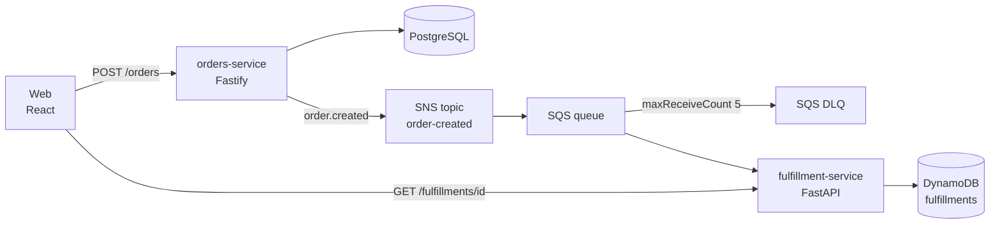
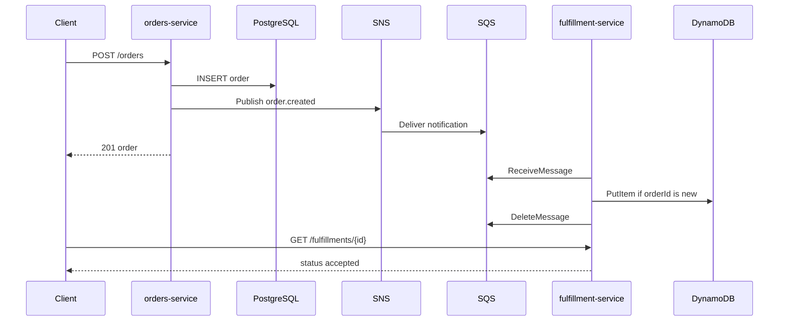

# Architecture

Brewdrop is a two-service order desk. The counter writes the order and emits a fact. The fulfillment desk reacts to that fact. Neither service calls the other over HTTP.

If SNS publish fails, the order row stays and the API returns 503. The same `Idempotency-Key` publishes the original event id. If the consumer fails, the message stays invisible until the visibility timeout and is then retried. After five receives it lands on the DLQ. A duplicate event for an order that is already accepted is deleted and does not change the DynamoDB item.

Production targets are RDS PostgreSQL, the real SNS/SQS/DynamoDB resources, ECR, and EKS. Those are declared in Terraform and are not created by the Helm chart. Locally, Compose replaces RDS with Postgres and the AWS APIs with LocalStack. Resource names differ; both services read them from the environment.

Kubernetes runs the two processes. IRSA roles in Terraform match the service account names `orders` and `fulfillment` in the `delivery` namespace.
